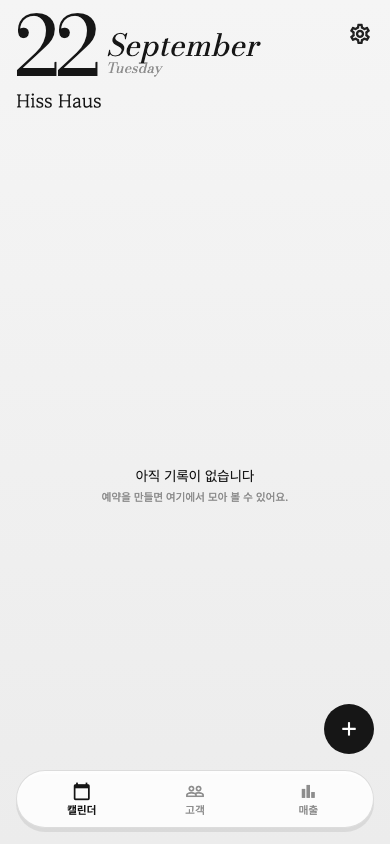
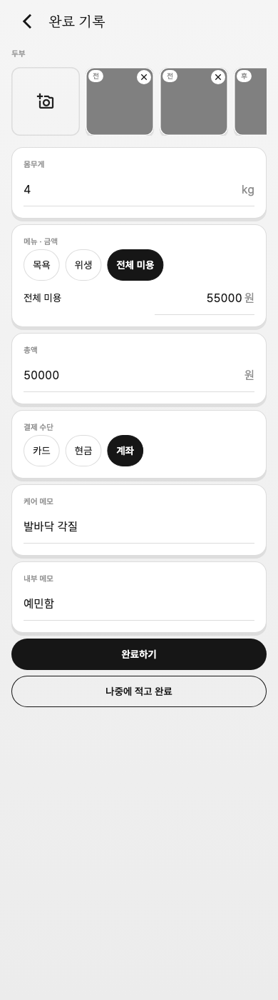
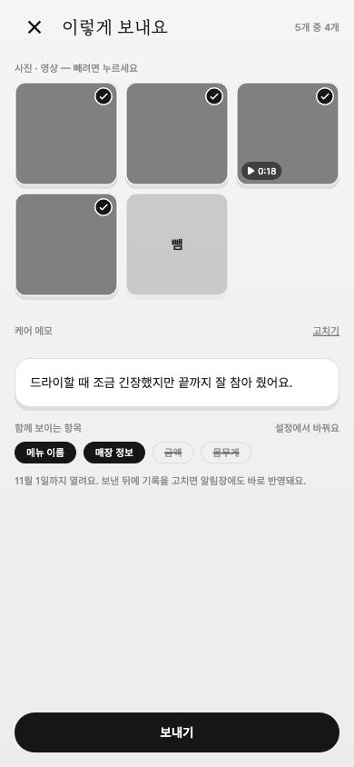
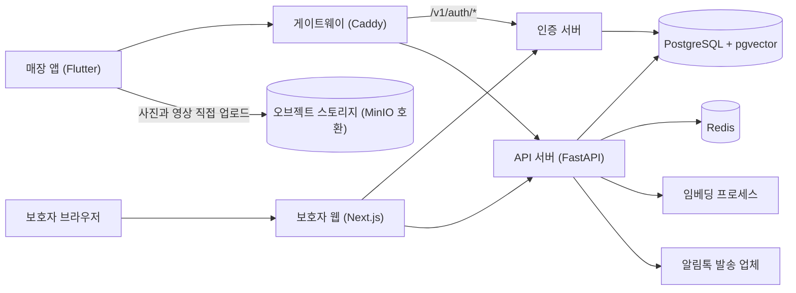

# 차곡노트

반려동물 미용 매장이 예약, 고객, 미용 기록을 한 앱에서 관리하고, 보호자에게는 링크 하나로 미용 알림장을 보내는 서비스입니다.

포트폴리오 소개 페이지: https://chagocnote.jangminseok.com <br>
상태: 개발 중입니다. 아직 운영 서버에 배포하지 않았습니다.

[](https://github.com/jangminseok-dev/com.chagocnote/actions/workflows/backend.yml)
[](https://github.com/jangminseok-dev/com.chagocnote/actions/workflows/app.yml)
[](https://github.com/jangminseok-dev/com.chagocnote/actions/workflows/web.yml)

<p>
  
  
  
</p>

위 화면은 앱 화면 테스트가 비교 기준으로 쓰는 이미지입니다. 들어 있는 이름과 숫자는 테스트용으로 지어낸 값입니다.

## 한눈에 보기

| 항목 | 내용 |
|---|---|
| 기간 | 2026-09-20 ~ 2026-11-17 (main 첫 커밋과 마지막 커밋 날짜, 아직 진행 중) |
| 인원과 역할 | 1인 개발입니다. 설계, 서버, 매장용 앱, 보호자용 웹, 개발 환경을 혼자 맡았습니다. |
| 상태 | 개발 중 (운영 배포 전) |
| 주요 기술 | Python 3.13, FastAPI, SQLAlchemy 2, PostgreSQL(pgvector), Redis, Flutter, Next.js 16, Docker Compose, GitHub Actions |

## 주요 기능

- **예약 달력**: 한 달 달력에서 날짜마다 예약 수를 보고, 하루 일정을 시간순으로 확인합니다. 보호자가 보낸 카카오톡 글을 붙여 넣으면 날짜, 시각, 메뉴를 짐작해 예약 칸을 미리 채웁니다. 사장님이 확인해야 저장되고, 지금은 정해 둔 규칙으로 글을 읽습니다.
- **미용 기록**: 미용 전후 사진과 영상을 방문 기록에 붙입니다. 올리는 도중에 인터넷이 끊겨도 남은 단계부터 이어서 올립니다. 메모는 손으로 치지 않고 말로 받아쓸 수 있습니다.
- **보호자 알림장**: 보호자는 앱 설치나 로그인 없이 매장이 보낸 링크로 그날의 사진, 영상, 케어 메모를 봅니다. 매장 내부 메모는 보이지 않고, 매장은 링크를 언제든 끊을 수 있습니다.
- **알림톡 자동 발송**: 예약 접수, 전날 안내, 예약 변경과 취소, 알림장을 매장 카카오톡 채널 이름으로 보내도록 만들었습니다. 개발 환경에서는 실제로 보내지 않는 가짜 발송으로 흐름을 확인합니다.
- **보호자 회원과 서류**: 로그인한 보호자는 지난 알림장과 몸무게 변화를 모아 보고 가족을 초대할 수 있습니다. 첫 방문 문진표와 미용 동의서도 링크로 보내 보호자가 로그인 없이 적고 서명합니다.
- **찾기, 매출, 다시 올 때**: 전화번호 뒷자리, 이름, 초성으로 고객을 찾고, 미용 기록의 글을 낱말이나 비슷한 뜻으로 찾습니다. 달마다 매출과 목표를 보고, 아이마다 미용 주기를 계산해 다시 올 때가 된 아이를 알려 줍니다.

## 구조



사장님은 매장 앱을 쓰고, 보호자는 링크로 웹 알림장을 엽니다. 로그인 토큰에 서명하는 키는 인증 서버만 가지고, API 서버는 토큰을 확인만 합니다. 사진과 영상은 서버를 거치지 않고, 서버가 내준 임시 업로드 주소로 오브젝트 스토리지에 바로 올라갑니다.

서버 코드는 매장, 고객, 방문, 미디어, 알림, 보호자, 검색 같은 기능 모듈(`backend/apps/`)로 나뉩니다. 모듈끼리는 서로의 코드를 직접 가져다 쓰지 않고 가운데의 `hub` 모듈에 정해 둔 약속만 봅니다. 여러 매장이 한 데이터베이스를 함께 쓰므로, 매장 데이터를 다루는 요청은 매번 그 사람이 매장 소속인지 다시 확인합니다. 자세한 규칙은 [`_docs/architecture.md`](_docs/architecture.md)에 있습니다.

## AI와 함께 만든 방식

이 저장소는 Claude Code로 만들었습니다. 사람은 무엇을 만들지와 어디까지 허용할지를 정하고, 결과는 테스트와 자동 검사로 확인합니다.

- **규칙 문서로 에이전트를 묶습니다.** 루트 [`CLAUDE.md`](CLAUDE.md)를 포함해 `CLAUDE.md`가 22개 있습니다. 예를 들어 "모듈끼리 직접 가져다 쓰지 않는다", "알림장 링크 값과 전화번호를 로그에 남기지 않는다", "검색어와 검색 결과 문장을 로그에 남기지 않는다", "데이터베이스 잠금 순서" 같은 규칙을 적어 두고, 에이전트가 작업 전에 읽게 합니다.
- **설계를 먼저 쓰고, 계획을 쓰고, 구현합니다.** `docs/superpowers/specs/`에 설계 문서 21개, `docs/superpowers/plans/`에 구현 계획 47개가 있습니다. 기능 묶음마다 설계, 계획, 구현, 테스트, 최종 검토 순서로 진행했습니다.
- **계획의 코드를 먼저 따로 돌려 봅니다.** 계획을 확정하기 전에 별도 참조 브랜치에서 계획의 코드를 실행해 테스트가 통과하는지 봅니다. 코드를 일부러 망가뜨렸을 때 테스트가 실패하는지도 확인합니다. 커밋 메시지에 그 기록이 남아 있습니다(예: `8f293c5` "참조 구현에서 먼저 검증(변이 179)", `a139001` "단위 1294→1867, 통합 405→485, 변이 116").
- **설계와 다르게 간 것은 결정 기록으로 남깁니다.** [`_docs/decisions/`](_docs/decisions/)에 결정 기록이 16개 있습니다. 일부러 막지 않은 동작과 감수하는 위험도 여기에 적었습니다.
- **커밋 기록**: main의 커밋 658개 가운데 633개에 Claude 공동 작성자 표시가 있습니다. 사람이 직접 고른 사항을 "사용자 결정"으로 밝힌 커밋은 6개입니다(예: `4df958e` CI에서 바뀐 영역만 검사, `1dc625c` 개발용 저장소 이미지 교체, `4647b70` 의존성 버전 고정).

## 검증

| 영역 | 무엇으로 확인하나 | 테스트 파일 수 |
|---|---|---|
| 서버 | pytest 단위 테스트와, 실제 PostgreSQL과 Redis에 붙는 통합 테스트 | `test_*.py` 408개 |
| 서버 구조 | import-linter 계약 6종 (계층 방향, 모듈끼리 독립, 도메인 순수성 등) | `backend/.importlinter` |
| 서버 흐름 | 게이트웨이를 거쳐 실제 요청을 보내는 흐름 확인 스크립트 | `backend/scripts/check_*_flow.sh` 16개 |
| 매장 앱 | `flutter analyze`(경고 0), 위젯 테스트와 화면 비교 이미지 52장, 시뮬레이터 흐름 테스트 | 단위 175개, 흐름 18개 |
| 보호자 웹 | Vitest 단위 테스트, 빌드와 형 검사, 가짜 백엔드로 서버 응답 검사, Playwright 브라우저 테스트 | 단위 29개, 브라우저 5개 |
| 기록 검색 품질 | 지어낸 미용 기록 60개와 질문 30개로 정답이 위 5개 안에 드는지 셉니다. 기준 24개, 결과 26개 ([결정 기록 013](_docs/decisions/013-record-search.md)) | `backend/scripts/check_search_quality.py` |

GitHub Actions 워크플로 3개([backend](.github/workflows/backend.yml), [app](.github/workflows/app.yml), [web](.github/workflows/web.yml))가 푸시마다 바뀐 영역의 검사를 돌립니다. 화면 비교 이미지, 브라우저 테스트, 흐름 스크립트는 개발 서버나 맥 환경이 필요해서 로컬에서만 돌립니다.

로그인 없이 열리는 주소는 허용 목록에 있는 것만 가능합니다. 서버에 등록된 모든 주소를 자동으로 훑어, 소속 확인이 빠진 주소가 생기면 테스트가 실패합니다(`dcc2659`, [`backend/tests/route_inspection.py`](backend/tests/route_inspection.py)).

검토와 테스트로 잡아 고친 예입니다.

- `b01917f` 알림장 링크의 실패 횟수 제한을 처음에는 IP 단위로 걸었습니다. 같은 공인 IP를 쓰는 보호자 전체가 남의 실패 때문에 막힐 수 있어서, 서명이 틀린 요청에만 제한을 걸도록 고쳤습니다.
- `a4fd5e0` 데이터베이스 오류 로그에 SQL 파라미터(고객 정보가 들어갈 수 있는 값)가 새지 않게 막았습니다.
- `e2d67ef`, `60914cb` 같은 리프레시 토큰이 동시에 두 번 쓰이면 알아채지 못하던 경합과, 모든 세션을 끊는 도중의 경합을 고쳤습니다.

## 시작하기

필요한 것: Docker(Compose 포함). 앱은 Flutter 3.41 이상, 웹 테스트는 Node.js와 pnpm이 맥에 있어야 합니다. 서버는 맥에 파이썬 환경을 만들지 않고 컨테이너 안에서만 돌립니다.

```bash
cd infra
docker compose build backend
docker compose run --rm --no-deps backend python scripts/generate_dev_env.py   # .env 와 .env.auth 를 만든다
docker compose up -d       # 게이트웨이 http://127.0.0.1:8080, 보호자 웹 http://127.0.0.1:3010
bash ../backend/scripts/check_auth_flow.sh                                      # 로그인 흐름 확인
```

테스트는 이렇게 돌립니다.

```bash
# 서버 (infra/ 에서)
docker compose run --rm backend pytest apps tests -q -p no:cacheprovider -m "not integration and not network"
docker compose run --rm backend pytest apps tests -q -p no:cacheprovider -m integration
docker compose run --rm --no-deps backend lint-imports --config .importlinter

# 앱 (app/ 에서)
flutter analyze
flutter test

# 웹 (web/ 에서, pnpm install 먼저)
pnpm test
pnpm build
```

개발 환경에서는 제공자 `dev`로 이름만 넣어 로그인합니다. 서버가 떠 있으면 `app/tool/run_dev.sh`로 앱을 켭니다(iOS 시뮬레이터 기준). 필수 환경 변수(`REPORT_LINK_KEY_B64`, `REPORT_WEB_SECRET`, 알림톡 키)와 이미 만든 개발 환경에 값을 더하는 방법은 [docs/SETUP.md](docs/SETUP.md)에 있습니다. 검증 명령 전체는 [`_docs/harness.md`](_docs/harness.md)에 있습니다.

## 폴더 구조

| 위치 | 내용 |
|---|---|
| `backend/` | 서버. 기능 모듈은 `apps/`, 공통 기반은 `core/`, DB 변경 이력은 `alembic/`, 확인 스크립트는 `scripts/` |
| `app/` | 매장용 Flutter 앱 (iOS, Android) |
| `web/` | 보호자 웹. 알림장, 내 기록, 동의서와 문진표 |
| `embed/` | 기록 검색의 뜻 검색에 쓰는 임베딩 프로세스 (CPU에서 도는 작은 모델) |
| `infra/` | Docker Compose 개발 환경과 게이트웨이 설정 |
| `_docs/` | 아키텍처 규칙, 검증 명령, 결정 기록 |
| `docs/` | 설계 문서, 구현 계획, 개발 환경 설정 |

## 문서

- [CLAUDE.md](CLAUDE.md): 꼭 지킬 규칙과 명령어 ([앱](app/CLAUDE.md), [웹](web/CLAUDE.md)은 따로 있습니다)
- [_docs/architecture.md](_docs/architecture.md): 계층, 기능 모듈과 허브, 폴더 이름 규칙
- [_docs/harness.md](_docs/harness.md): 검증 명령 전체
- [_docs/decisions/](_docs/decisions/): 결정 기록
- [docs/SETUP.md](docs/SETUP.md): 개발 환경 설정과 보호자 웹 안내 (예전 README 내용)
- [docs/superpowers/specs/](docs/superpowers/specs/), [docs/superpowers/plans/](docs/superpowers/plans/): 설계 문서와 구현 계획
